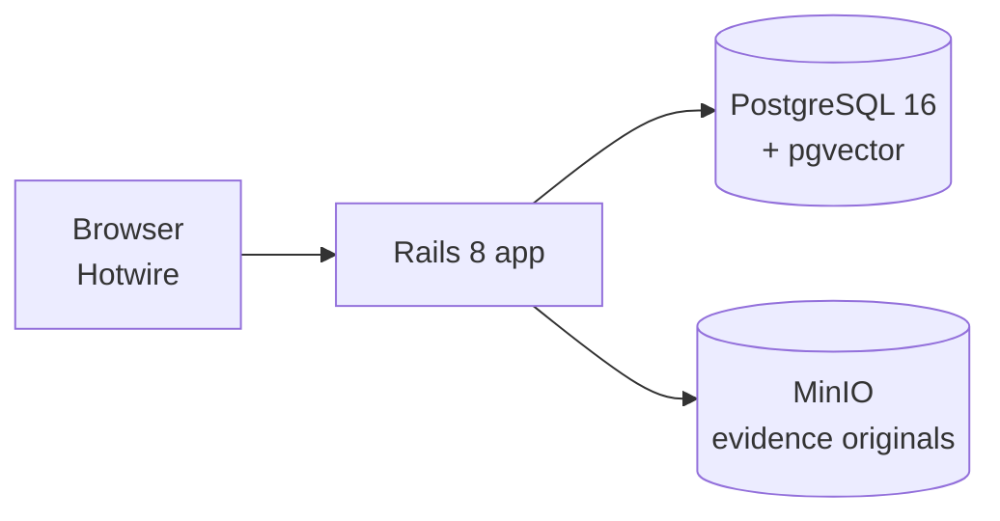

# TowerTrace

A Rails 8 case analysis app for **synthetic** phone records. An analyst creates a case, uploads call detail records from several fictional carriers, and TowerTrace normalizes them and shows the activity on a map, a timeline and a contact graph. Every number on screen traces back to a source file and row.

All data is synthetic. Phone numbers use the fictional `555 01XX` range and names come from a fixed fake-name list.

## Requirements

- Ruby 3.4.11 (pinned in `.ruby-version` and `mise.toml`; `mise install` sets it up)
- Docker with Compose v2
- libpq for the `pg` gem (macOS: `brew install libpq`, then `bundle config set --global build.pg --with-pg-config=$(brew --prefix libpq)/bin/pg_config`)

## Setup

```bash
bin/setup                  # bundle, copy .env.example to .env, start postgres + minio, prepare databases, start the server
bin/setup --skip-server    # same, without starting the server
bin/setup --skip-services  # don't touch Docker (services already running elsewhere)
```

### Running

```bash
docker compose up          # full stack: app on :3000, postgres on :5432, MinIO on :9000 (console :9001)
```

Or run Rails natively against the Compose services:

```bash
docker compose up -d postgres minio-init
bin/rails server
```

The MinIO console is at <http://localhost:9001> (credentials in `.env`).

## Tests

```bash
bin/rails test             # unit and integration tests
bin/rubocop                # lint
```

## Architecture



## Docs

- `docs/plan.md`: the current phase plan
- `docs/decisions.md`: design decisions and tradeoffs
